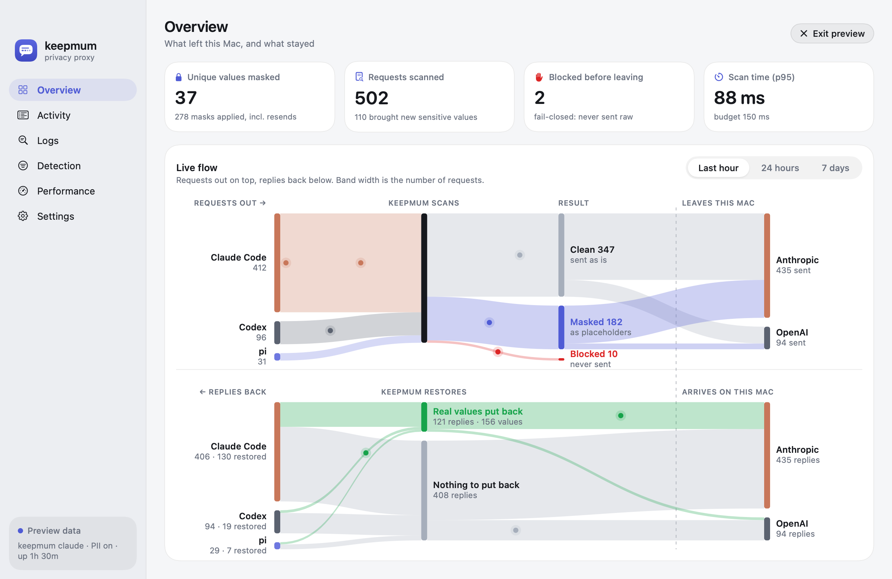

<p align="center"></p>

<h1 align="center">sotto</h1>

<p align="center"><b>Keep secrets and personal data on your Mac while you use Claude Code.</b></p>

sotto is a local proxy that sits between Claude Code and the Anthropic API. Before a request leaves your Mac, it finds secrets (API keys, tokens, passwords, private keys, connection strings) and, if you want, personal data (names, emails, phones, addresses, account numbers), and replaces each one with a placeholder such as `SOTTO_SECRET_7f3a9c2e`. When Claude answers, sotto puts the real values back, so Claude can still edit your `.env` file correctly, but Anthropic never sees what is in it.

Detection runs entirely on your Mac. Nothing is sent anywhere except the scanned request to Anthropic. The name comes from *sotto voce*, "in a low voice".

> **Status: pre-release.** sotto works end to end, but it has not been audited. Treat it as a safety layer, not a guarantee. See [Limitations](#limitations).



## How it works

```
Claude Code ──▶ sotto (on your Mac) ──▶ Anthropic API
   real values    detect → mask           placeholders only
              ◀── restore ◀──────────────
```

1. **Detect.** Two layers, cheapest first:
   - 27 gitleaks-style rules, plus entropy and checksum checks, for structured secrets.
   - [OpenAI Privacy Filter](https://huggingface.co/openai/privacy-filter), an open-weight token classifier, for secrets in context and, optionally, personal data. It runs in pf-serve, a small native program on [privacy-filter.cpp](https://github.com/localai-org/privacy-filter.cpp) that uses the Mac's GPU through Metal.
   - A deterministic refinement step then drops what the model gets wrong: UUIDs, hashes, request IDs, timestamps, paths, placeholders and documented example keys.
2. **Mask.** Each value becomes a placeholder derived from a secret per-install key (HMAC-SHA256). The same value always gets the same placeholder, so Anthropic's prompt cache keeps working. Values live only in memory and are cleared when sotto exits.
3. **Restore.** Placeholders in Claude's answers are swapped back on your Mac, including in streamed text and in tool inputs (file edits, shell commands). Network tools such as WebFetch, WebSearch and MCP tools keep placeholders, so a prompt-injected request cannot send a real value to the internet.
4. **Fail closed.** If scanning fails, the body is malformed, or a request targets an endpoint sotto does not scan, the request is blocked and never sent raw.

## Requirements

- A Mac with Apple silicon, and macOS 14 or later
- Python 3.12+, [uv](https://docs.astral.sh/uv/), and Xcode or its command line tools (to build pf-serve)
- Claude Code
- About 1.7 GB of free memory while sotto runs (the local model), and 1.6 GB of disk for it

## Install

### The Mac app (everything included)

Download `Sotto-<version>.dmg` from the [Releases](https://github.com/blueandhack/sotto/releases) page (or build it: [mac/README.md](mac/README.md)), drag Sotto into Applications, open it, and follow **Settings › Setup**: download the model, start the background service, and switch on **Protect Claude Code**. The app bundles sotto, its Python runtime and pf-serve; nothing else needs installing. Every Claude Code session then goes through sotto: terminal, VS Code and the desktop app.

### The command line

```sh
git clone https://github.com/blueandhack/sotto.git && cd sotto
uv tool install --editable .                # installs `sotto` and `sotto-claude-wrapper`
native/pf-serve/build.sh                    # builds pf-serve from pinned sources into ~/.local/share/sotto/bin
sotto setup                                 # downloads the model (1.6 GB, once), checked against its pinned SHA-256
sotto doctor                                # every line should be ✓
sotto selftest                              # sends a canary secret through sotto to a local mock; fails if it leaks
```

## Use

### In the terminal

```sh
sotto claude          # starts Claude Code with every request scanned; arguments pass through to `claude`
```

### In VS Code (Claude Code extension)

Add this to your VS Code settings (JSON), then reload the window:

```json
"claudeCode.claudeProcessWrapper": "/Users/<you>/.local/bin/sotto-claude-wrapper"
```

Each conversation then starts through sotto. If `sotto serve` is running, every conversation shares it (one model in memory); otherwise each conversation starts its own proxy.

### As a background proxy, for every session

```sh
sotto serve           # http://127.0.0.1:7788
sotto protect on      # Claude Code's user settings now send every session to it; `sotto protect off` undoes it
```

`sotto protect` changes one key, `env.ANTHROPIC_BASE_URL`, in `~/.claude/settings.json`, and keeps a backup next to it. Sessions already running switch over when it is turned on; turning it off reaches only sessions started afterwards. While it is on, `sotto serve` must keep running, or Claude Code cannot connect: the Mac app runs it at login. Claude Code turns off Remote Control when its base URL is not api.anthropic.com.

### Leave a project out

```sh
sotto exclude ~/Projects/some-repo     # Claude Code there goes straight to the API, unscanned
sotto exclude --list
sotto include ~/Projects/some-repo     # scan it again
```

`sotto exclude` sets `env.ANTHROPIC_BASE_URL` to sotto's upstream in the project's `.claude/settings.local.json` (at the git repository's root, as Claude Code reads it), which outranks `sotto protect`. That file is never committed: sotto refuses if git tracks it and otherwise adds it to `.git/info/exclude`. Claude Code applies it once you trust the folder; until then the project still goes through sotto. Open sessions there switch at once when you exclude, but keep going straight to the API after `sotto include` until they restart. In an excluded project the VS Code wrapper starts Claude Code without sotto, and `sotto claude` refuses. The Mac app lists exclusions in Settings.

### Scan files (pre-commit)

```sh
sotto scan path/to/file …    # prints file:line:col TYPE rule [N chars]; never prints the value; exits 1 on findings
```

## Configuration

Optional, in `~/.config/sotto/config.toml`. Unknown keys and bad values are errors.

```toml
[detect]
pii = false            # also mask names, emails, phones, addresses, account numbers

[allowlist]            # added to the built-in list (documented example keys, test cards)
strings = []
patterns = []

[restore]              # per tool: "restore" real values, or "keep" placeholders
default = "restore"
WebFetch = "keep"
WebSearch = "keep"
"mcp__*" = "keep"

[server]
port = 7788            # for `sotto serve`

[log]
level = "info"         # logs contain types and counts, never values
```

## What sotto stores, and where

| What | Where |
| --- | --- |
| Per-install key for placeholders | macOS Keychain (`sotto` / `install-salt`); falls back to `~/.config/sotto/salt` (0600) |
| Stats token for the Mac app | `~/.config/sotto/stats-token` (0600) |
| Logs: paths, types, counts and timings, never values | `~/.config/sotto/sotto.log` (0600) |
| Running proxy's port | `~/.config/sotto/runtime.json` (0600) |
| Masked values | Process memory only, cleared on exit |

sotto makes no network calls except the request it forwards, and `sotto setup`'s one model download. There is no telemetry and no update check.

## Mac app

A menu-bar app that sets sotto up and runs it in the background, with a dashboard: a live flow map of where each request goes, request and detection funnels, masked values by type, scan latency, and recent activity, in light and dark mode. It reads a local stats feed that carries counts only, so it cannot show a secret even by mistake. See [mac/README.md](mac/README.md) to build it.

## Accuracy and speed

Measured on synthetic, labeled datasets on an M5 Pro (details in [bench/results/PHASE0.md](bench/results/PHASE0.md), [MODELS.md](bench/results/MODELS.md) and [PFSERVE.md](bench/results/PFSERVE.md)):

| | Result |
| --- | --- |
| Secret recall | 0.989 to 1.000 across five datasets, four of them held out |
| Personal data (`pii = true`) | recall 0.996 to 1.000, precision 0.85 to 0.93 |
| Fake secrets wrongly flagged | 1 of 40 and 0 of 15 on the first two sets; **9, 3 and 3 of 15 on the three freshest held-out sets** (unusual ID formats; see below) |
| Time added per request | about 100 to 145 ms at the 95th percentile for 4K tokens of new text; earlier turns are cached |

No language model judges spans at request time. The Apple on-device model and Qwen3-4B were both measured and dropped: deterministic refinement removed more false positives, faster.

## Limitations

- **False positives on unusual identifiers.** On two fresh sets of hard negatives, 9 of 15 and 3 of 15 were flagged (memory addresses, Azure resource IDs, Stripe object IDs, Kubernetes pod hashes, AWS VPC and security group IDs, Xcode build folders, and IDs right after the word "key", such as idempotency keys). Over-masking costs Claude some context but never leaks. A small trained classifier is planned for this.
- **Images and PDFs pass through unscanned.**
- **Local transcripts keep real values.** Claude Code's history on your disk is restored, so it holds real values. sotto protects what leaves your Mac, not what is stored on it.
- **Shell commands receive real values.** Claude can still run a command that sends a restored secret somewhere. Use it together with [Claude Code's sandbox](https://code.claude.com/docs/en/sandboxing), whose network allowlist stops that. sotto controls what Anthropic sees; the sandbox controls what commands can do.
- **English-first.** The local model is strongest on English text.
- **macOS on Apple silicon only.** Codex support is being explored.

## Development

```sh
uv sync
uv run pytest                                # unit, property, proxy, streaming and launcher tests
uv run python bench/gen.py                   # generate the benchmark datasets
uv run python bench/run.py                   # accuracy and speed; see bench/README.md
```

The design and milestones are in [SPEC.md](docs/SPEC.md).

## Trademarks

Claude, Claude Code and Anthropic are trademarks of Anthropic, PBC. The Mac app shows their logos, from Anthropic's press kit, to identify the services sotto works with (see [mac/Brand/NOTICE.md](mac/Brand/NOTICE.md)). sotto is an independent project, not affiliated with or endorsed by Anthropic. OpenAI Privacy Filter is released by OpenAI under Apache-2.0.

## License

Apache-2.0.
