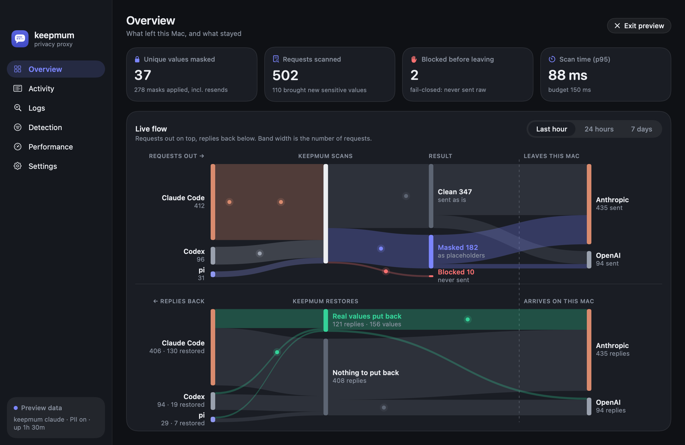
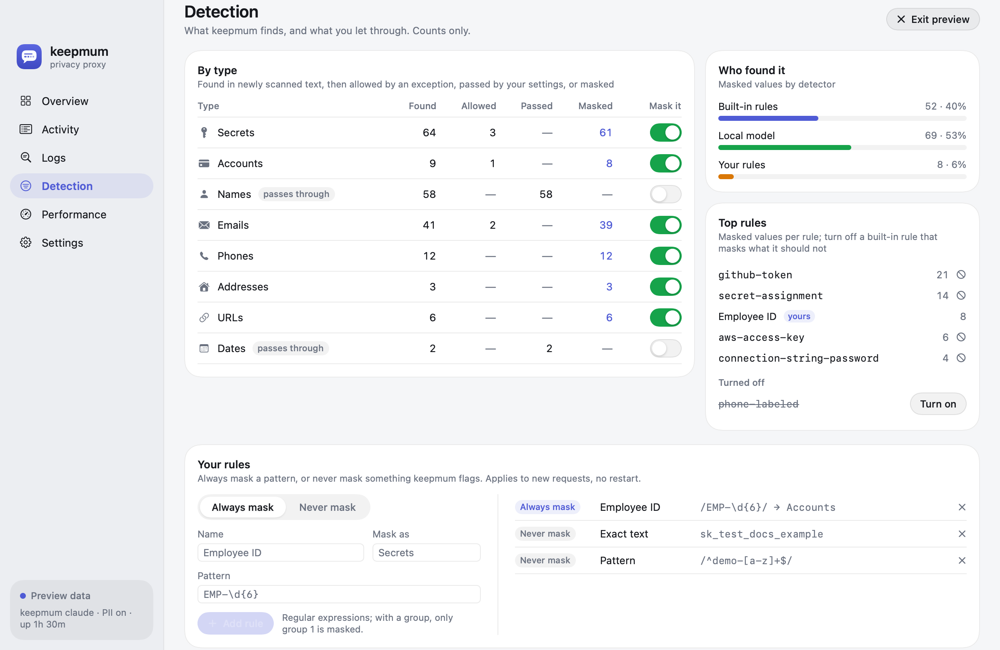
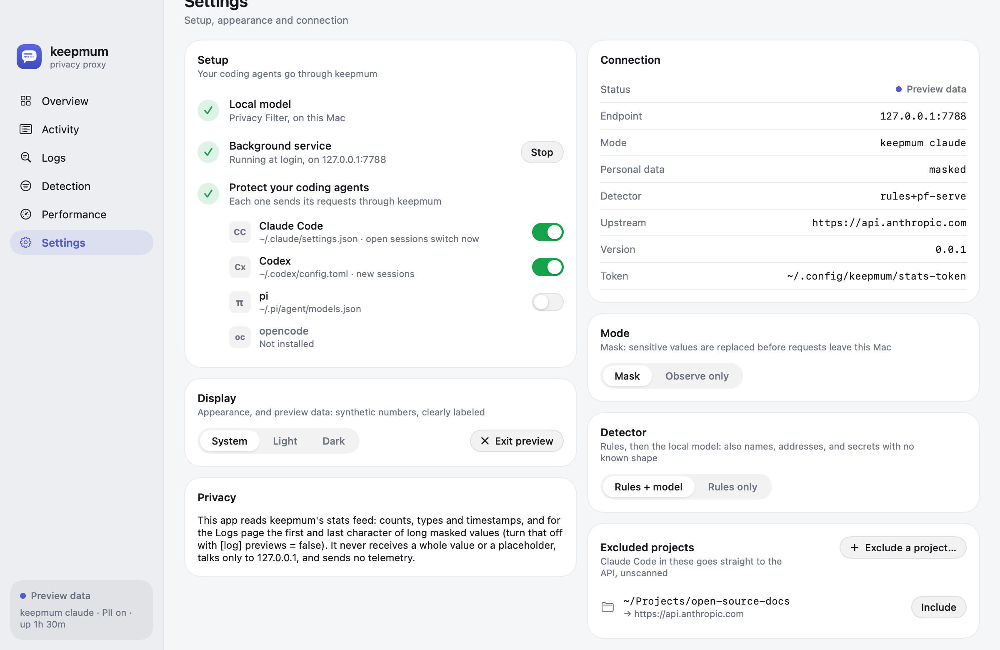
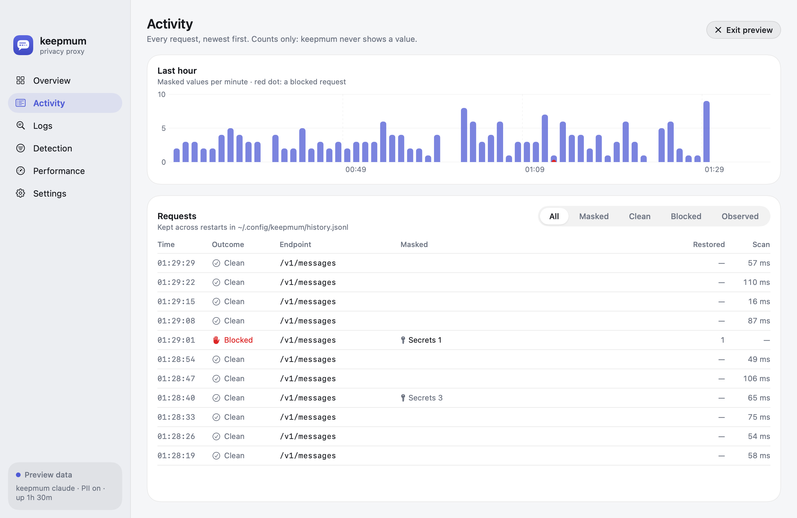

<p align="center"></p>

# keepmum for Mac

A menu-bar app that sets keepmum up, runs it in the background and shows what it does, in light and dark mode. The logo is a speech bubble where one word became placeholders: what keepmum does to every request, keeping mum about the secret.

- **Overview:** key numbers and the live flow: two flow diagrams on shared columns, requests going out (client → keepmum's scan → clean, masked, observed or blocked → provider) and replies coming back (provider → keepmum's restore → client). Band width is the number of requests over the last hour, 24 hours or 7 days, and each live request travels its route as a dot. Each coding agent (Claude Code, Codex, pi) gets its own band, told apart by its User-Agent or the header `keepmum protect` adds. Hovering a band highlights it; hovering an agent or provider highlights its whole route in both diagrams.
- **Activity:** every request, newest first, kept across restarts in `~/.config/keepmum/history.jsonl`: outcome (masked, clean, blocked, observed), what was masked and restored, and scan time, filterable by outcome, with older pages on demand; plus a per-minute chart.
- **Logs:** every value masked in new text, newest first, searchable and filterable by type: the agent, the type, the first and last character (`g…w`; values shorter than 8 characters show only dots), the length, and the rule or detector that found it. Kept in keepmum's memory only: the list starts empty when keepmum starts.
- **Detection:** per type, how many values were found, allowed by an exception, passed through by your settings, and masked, with a switch to stop masking a type (names, dates…; secrets ask first); which detector found them (built-in rules, the local model, your rules) and the top rules, each built-in one with a button to turn it off; and your own rules: patterns always masked and exceptions never masked.
- **Performance:** scan time against the 150 ms budget, and its distribution.
- **Settings:** Setup (download the model, start the background service, one protection switch per coding agent), Mode (mask, or observe only), Detector (the rules and the local model, or the rules alone: `keepmum model`), excluded projects (`keepmum exclude`), display (appearance and preview data), connection details.
- **Menu bar:** the key numbers, which agents are protected, and a shortcut to the dashboard.







**Privacy.** The app reads keepmum's local feeds (`/_keepmum/stats`, `/_keepmum/flows`, `/_keepmum/history`, `/_keepmum/findings`), which carry counts, types and timestamps, never a placeholder or a whole value. The Logs feed (`/_keepmum/findings`) also carries the first and last character of each masked value of 8 or more characters; it lives in keepmum's memory only, and `[log] previews = false` in keepmum's config turns it off and forgets what was kept. It finds the proxy through `~/.config/keepmum/runtime.json` (written by `keepmum claude` and `keepmum serve`; port 7788 otherwise). It authenticates with the token in `~/.config/keepmum/stats-token` (mode 0600). It talks only to 127.0.0.1, sends no telemetry, and checks for no updates.

```sh
./build-app.sh                  # build/Keepmum.app with the engine, signed with your Apple Development identity (or ad-hoc)
SKIP_RUNTIME=1 ./build-app.sh   # the dashboard alone, for UI work
open build/Keepmum.app
```

**What the app bundles** (`bundle-runtime.sh`, about 95 MB): a relocatable CPython 3.12 with keepmum and its locked dependencies, pf-serve built from pinned sources, the `keepmum` command the app runs for setup and protection, and a LaunchAgent (`Contents/Library/LaunchAgents/app.keepmum.agent.plist`) that runs `keepmum serve` at login, registered with SMAppService. The bundled Python runs isolated (`-I`) and never writes into the signed bundle (`-B`; everything is compiled at build time). The model (1.6 GB) is downloaded on first use into `~/.local/share/keepmum`, which the command line shares. The app and the command line share one placeholder key, `~/.config/keepmum/salt` (0600), so a placeholder made by either is restored by the other.

**Setup**, in Settings, takes three steps, each also available on the command line: download the model (`keepmum setup`; not needed with Detector set to rules only), start the background service (macOS may ask you to allow it in System Settings › Login Items), and **Protect your coding agents**, one switch each for Claude Code, Codex, pi and opencode (`keepmum protect on --client …`). A switch turns on only while the service runs, and stopping the service turns protection off for every agent first, so no agent is pointed at a proxy that is not there.

- **Preview** shows animated sample data, clearly labeled, when keepmum is not running.
- `Keepmum --snapshot dir` renders every page in light and dark to PNGs and exits; with `--live` it renders the overview from the running proxy.
- Development-signed builds run only on this Mac. For other Macs, see Releasing.

## Releasing

A release is a notarized `Keepmum-<version>.dmg` on the repository's GitHub Releases page. Apple's notarization is what lets the app open on other Macs without a warning; it needs a paid Apple Developer membership.

**Once per Mac:**

1. **Developer ID certificate.** Xcode › Settings › Accounts › your team › Manage Certificates › **+** › *Developer ID Application* (only the account holder can create one). Check: `security find-identity -v -p codesigning` lists `Developer ID Application: …`.
2. **Notary credentials**, kept in the Keychain. Create an app-specific password at account.apple.com › Sign-In and Security, then:
   ```sh
   xcrun notarytool store-credentials keepmum-notary --apple-id you@example.com --team-id ABCDE12345
   ```
   It asks for the password and checks it with Apple.

**Each release:**

```sh
# 1. bump `version` in pyproject.toml, commit
mac/release.sh                                  # tests, build, Developer ID signature, notarize, staple -> dist/
git tag -s v0.1.0 -m "keepmum 0.1.0" && git push origin main v0.1.0
gh release create v0.1.0 dist/Keepmum-0.1.0.dmg dist/Keepmum-0.1.0.dmg.sha256 \
  --verify-tag --title "keepmum 0.1.0" --generate-notes --prerelease
```

`release.sh` refuses an uncommitted tree, notarizes the app and then the DMG, staples both tickets (so the app opens offline after it is copied out), and ends by asking Gatekeeper (`spctl`) for the verdict another Mac would reach. A rejected submission prints Apple's log. `SKIP_NOTARIZE=1 ALLOW_DIRTY=1 mac/release.sh` runs every other step with your development identity, to test it.

Users download the DMG, drag Keepmum into Applications, open it, and follow Settings › Setup. Drop `--prerelease` once keepmum leaves pre-release. Release builds happen on a Mac you control rather than in CI, so the signing certificate never leaves it.

**Logos.** Claude Code and the Anthropic API appear with their official logos (`Brand/`, from Anthropic's [press kit](https://www.anthropic.com/press-kit), used unmodified to identify those services; see [Brand/NOTICE.md](Brand/NOTICE.md)). Claude, Claude Code and Anthropic are trademarks of Anthropic, PBC; keepmum is an independent project, not affiliated with or endorsed by Anthropic. "This Mac" shows a laptop or a Mac mini, depending on whether the Mac has a battery.

Requires macOS 14 or later.
